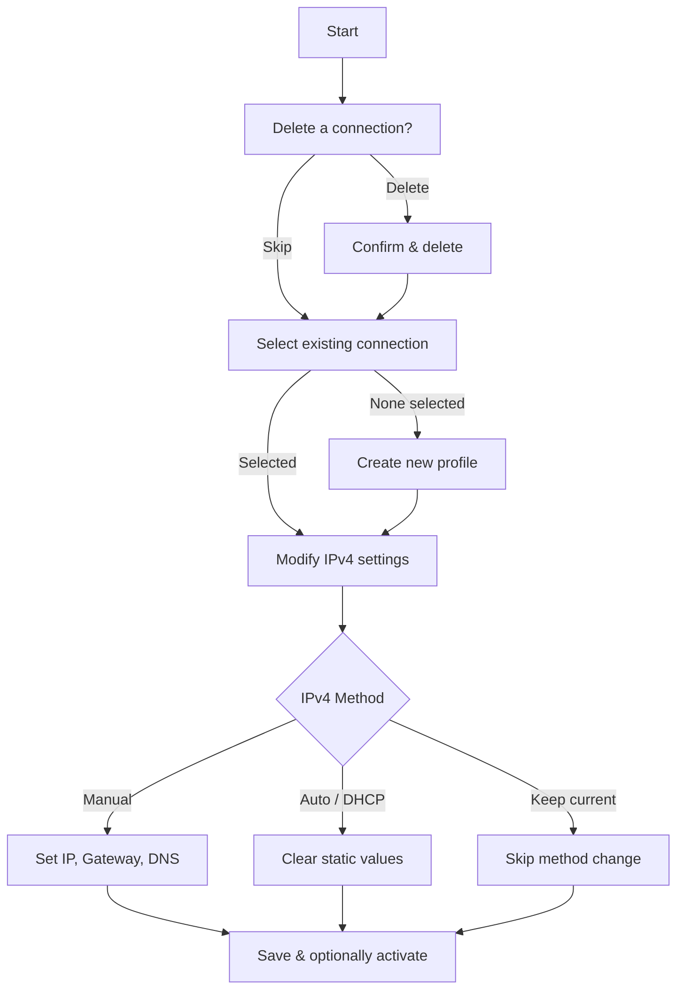

<div align="center">

# 🌐 pynmcli

**Interactive NetworkManager connection configurator for Linux**

[](https://www.python.org/)
[](LICENSE)
[](https://www.kernel.org/)

A lightweight, interactive CLI tool written in Python that wraps `nmcli` to simplify the management of NetworkManager connections — list, create, modify, and delete network profiles without memorizing complex `nmcli` syntax.

[Features](#-features) · [Quick Start](#-quick-start) · [Usage](#-usage) · [Project Structure](#-project-structure) · [License](#-license)

</div>

---

## ✨ Features

| Feature | Description |
|---------|-------------|
| 📋 **List connections** | Displays all existing NetworkManager connection profiles |
| 🗑️ **Delete connections** | Remove unwanted profiles with a confirmation prompt |
| ➕ **Create profiles** | Add new connection profiles (ethernet, wifi, etc.) interactively |
| ✏️ **Modify IPv4 settings** | Configure static IP, gateway, DNS, or switch to DHCP |
| ✅ **Input validation** | Validates IP addresses, gateways, and DNS entries using Python's `ipaddress` module |
| 🎨 **Color-coded output** | Clear visual feedback with colored terminal messages |
| 🔄 **Activate on the fly** | Optionally bring up the connection immediately after configuration |

## 📋 Requirements

- **OS:** Linux (any distribution with NetworkManager)
- **Python:** 3.x
- **System dependency:** `nmcli` (provided by the `NetworkManager` package)
- **Permissions:** Root or sudo privileges to modify network connections

## 🚀 Quick Start

### 1. Clone the repository

```bash
git clone https://github.com/DcastrGD/pynmcli.git
cd pynmcli
```

### 2. Run the tool

```bash
python3 pycli.py
```

> [!TIP]
> You can also use the included `setup.py` installer:
> ```bash
> python3 setup.py
> ```

## 📖 Usage

The tool guides you through a step-by-step interactive flow:

### Step 1 — Delete a connection (optional)

```
Conexiones disponibles:

NAME        UUID                                  TYPE      DEVICE
enp0s3      a1b2c3d4-...                          ethernet  enp0s3

[*] Nombre de la conexión a eliminar (ENTER para saltar):
```

Press **Enter** to skip or type the connection name to delete it (with confirmation).

### Step 2 — Select or create a connection

```
[*] Selecciona una conexión (ENTER para crear una nueva):
```

- **Type a name** → selects an existing connection to modify.
- **Press Enter** → the tool prompts you to create a new profile, asking for:
  - Connection name
  - Interface type (`ethernet`, `wifi`, etc.)
  - Device name (e.g., `enp0s3`)

### Step 3 — Configure IPv4

```
Método IPv4:
1. Manual (IP estática)
2. Auto (DHCP)
3. Mantener el método actual
Selecciona una opción:
```

If you choose **Manual**, you will be prompted for:

| Field | Example | Required |
|-------|---------|----------|
| IP address with prefix | `192.168.1.20/24` | ✅ |
| Gateway | `192.168.1.1` | ❌ |
| DNS servers | `8.8.8.8,1.1.1.1` | ❌ |

All entries are validated before being applied. After saving, you can optionally activate the connection immediately.

> [!IMPORTANT]
> Modifying network connections requires root privileges. Run with `sudo` if you encounter permission errors:
> ```bash
> sudo python3 pycli.py
> ```

## 📁 Project Structure

```
pynmcli/
├── pycli.py        # Main interactive CLI tool
├── setup.py        # Installation helper script
├── install.sh      # Alternative installer
├── LICENSE          # MIT License
├── README.md        # Documentation (English)
└── README_es.md     # Documentation (Español)
```

## 🔧 How It Works

`pynmcli` is built around the `NMCLI_CONFIGS` class which provides a clean wrapper over `nmcli` commands:



## 🤝 Contributing

Contributions are welcome! Feel free to open an issue or submit a pull request.

1. Fork the repository
2. Create your feature branch (`git checkout -b feature/my-feature`)
3. Commit your changes (`git commit -m 'Add my feature'`)
4. Push to the branch (`git push origin feature/my-feature`)
5. Open a Pull Request

## 📄 License

This project is licensed under the **MIT License** — see the [LICENSE](LICENSE) file for details.

---

<div align="center">

Made with ❤️ by [DcastrGD](https://github.com/DcastrGD)

</div>
