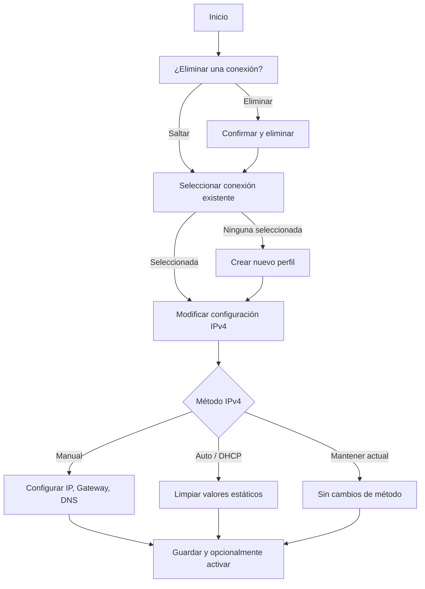

<div align="center">

# 🌐 pynmcli

**Configurador interactivo de conexiones NetworkManager para Linux**

[](https://www.python.org/)
[](LICENSE)
[](https://www.kernel.org/)

Herramienta CLI interactiva y ligera escrita en Python que envuelve `nmcli` para simplificar la gestión de conexiones de NetworkManager — listar, crear, modificar y eliminar perfiles de red sin necesidad de memorizar la sintaxis de `nmcli`.

[Características](#-características) · [Inicio Rápido](#-inicio-rápido) · [Uso](#-uso) · [Estructura](#-estructura-del-proyecto) · [Licencia](#-licencia)

</div>

---

## ✨ Características

| Característica | Descripción |
|----------------|-------------|
| 📋 **Listar conexiones** | Muestra todos los perfiles de conexión existentes en NetworkManager |
| 🗑️ **Eliminar conexiones** | Elimina perfiles no deseados con confirmación previa |
| ➕ **Crear perfiles** | Añade nuevos perfiles de conexión (ethernet, wifi, etc.) de forma interactiva |
| ✏️ **Modificar IPv4** | Configura IP estática, puerta de enlace, DNS o cambia a DHCP |
| ✅ **Validación de entrada** | Valida direcciones IP, gateways y DNS usando el módulo `ipaddress` de Python |
| 🎨 **Salida con colores** | Mensajes claros en la terminal con código de colores |
| 🔄 **Activar al instante** | Opción de levantar la conexión inmediatamente tras la configuración |

## 📋 Requisitos

- **SO:** Linux (cualquier distribución con NetworkManager)
- **Python:** 3.x
- **Dependencia del sistema:** `nmcli` (proporcionado por el paquete `NetworkManager`)
- **Permisos:** Root o sudo para modificar conexiones de red

## 🚀 Inicio Rápido

### 1. Clonar el repositorio

```bash
git clone https://github.com/DcastrGD/pynmcli.git
cd pynmcli
```

### 2. Ejecutar la herramienta

```bash
python3 pycli.py
```

> [!TIP]
> También puedes usar el instalador incluido `setup.py`:
> ```bash
> python3 setup.py
> ```

## 📖 Uso

La herramienta te guía a través de un flujo interactivo paso a paso:

### Paso 1 — Eliminar una conexión (opcional)

```
Conexiones disponibles:

NAME        UUID                                  TYPE      DEVICE
enp0s3      a1b2c3d4-...                          ethernet  enp0s3

[*] Nombre de la conexión a eliminar (ENTER para saltar):
```

Pulsa **Enter** para saltar o escribe el nombre de la conexión para eliminarla (con confirmación).

### Paso 2 — Seleccionar o crear una conexión

```
[*] Selecciona una conexión (ENTER para crear una nueva):
```

- **Escribe un nombre** → selecciona una conexión existente para modificarla.
- **Pulsa Enter** → la herramienta te pregunta si quieres crear un nuevo perfil, pidiendo:
  - Nombre de la conexión
  - Tipo de interfaz (`ethernet`, `wifi`, etc.)
  - Nombre del dispositivo (ej. `enp0s3`)

### Paso 3 — Configurar IPv4

```
Método IPv4:
1. Manual (IP estática)
2. Auto (DHCP)
3. Mantener el método actual
Selecciona una opción:
```

Si eliges **Manual**, se te pedirá:

| Campo | Ejemplo | Obligatorio |
|-------|---------|-------------|
| Dirección IP con prefijo | `192.168.1.20/24` | ✅ |
| Puerta de enlace | `192.168.1.1` | ❌ |
| Servidores DNS | `8.8.8.8,1.1.1.1` | ❌ |

Todas las entradas se validan antes de aplicarse. Tras guardar, puedes activar la conexión inmediatamente de forma opcional.

> [!IMPORTANT]
> Modificar conexiones de red requiere privilegios de root. Ejecuta con `sudo` si encuentras errores de permisos:
> ```bash
> sudo python3 pycli.py
> ```

## 📁 Estructura del Proyecto

```
pynmcli/
├── pycli.py         # Herramienta CLI interactiva principal
├── setup.py         # Script de instalación
├── install.sh       # Instalador alternativo
├── LICENSE          # Licencia MIT
├── README.md        # Documentación (English)
└── README_es.md     # Documentación (Español)
```

## 🔧 Cómo Funciona

`pynmcli` está construido alrededor de la clase `NMCLI_CONFIGS`, que proporciona un wrapper limpio sobre los comandos de `nmcli`:



## 🤝 Contribuir

¡Las contribuciones son bienvenidas! No dudes en abrir un issue o enviar un pull request.

1. Haz un fork del repositorio
2. Crea tu rama de feature (`git checkout -b feature/mi-feature`)
3. Haz commit de tus cambios (`git commit -m 'Añadir mi feature'`)
4. Sube la rama (`git push origin feature/mi-feature`)
5. Abre un Pull Request

## 📄 Licencia

Este proyecto está licenciado bajo la **Licencia MIT** — consulta el archivo [LICENSE](LICENSE) para más detalles.

---

<div align="center">

Hecho con ❤️ por [DcastrGD](https://github.com/DcastrGD)

Proyecto personal con Python para trabajar con herramientas de red en Linux.

</div>
